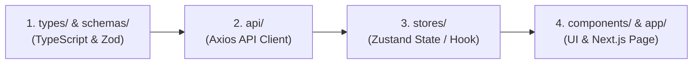
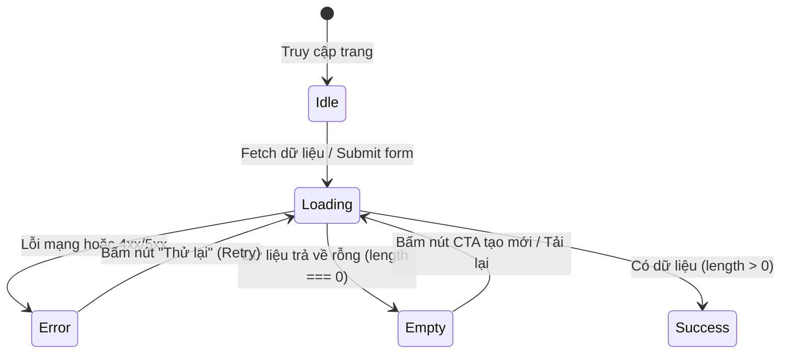

# 🎨 QUY CHUẨN PHÁT TRIỂN FRONTEND (FRONTEND STANDARDS)

> **Môi trường kỹ thuật**: Next.js 16 (App Router) / React 19 / TypeScript / Tailwind CSS v4 / Zustand 5 / Zod 4 / React Hook Form.  
> **Mục tiêu**: Đảm bảo cấu trúc Feature-Driven nhất quán, type-safe từ tầng API đến giao diện, xử lý trọn vẹn 4 trạng thái UI và ngăn chặn nhầm lẫn kiến trúc giữa các lập trình viên & AI Agent.

---

## 1. Triển Khai Song Song Trọn Gói (Full Feature Ownership)

Mỗi module nghiệp vụ khi triển khai tuân theo **quy trình 4 bước chuẩn**:



1. **Bước 1 (`types/` & `schemas/`)**: Khai báo TypeScript Interfaces và tách riêng Zod Schema để validate form.
2. **Bước 2 (`api/`)**: Xây dựng hàm gọi API thông qua Axios Client (kế thừa các kiểu DTO từ bước 1).
3. **Bước 3 (`stores/`)**: Tạo Zustand Store quản lý State, xử lý bất đồng bộ (loading/error) và lưu trữ dữ liệu.
4. **Bước 4 (`components/` & `app/`)**: Xây dựng UI Components tái sử dụng Base UI Kit và gắn vào trang tương ứng trong `app/`.

---

## 2. Cấu Trúc Thư Mục Feature-Driven & Quy Tắc Đặt Tên

### 2.1. Cấu trúc thư mục chuẩn

```text
frontend/src/
├── app/                        # Next.js App Router (layout, page, loading, error, not-found)
│   ├── (auth)/                 # Route Group cho Đăng nhập / Đăng ký
│   ├── (shop)/                 # Route Group cho Khách hàng (Sản phẩm, Giỏ hàng, Đơn hàng)
│   ├── (admin)/                # Route Group cho Quản trị viên
│   ├── loading.tsx             # Global loading fallback (Streaming)
│   ├── error.tsx               # Global error boundary ("use client")
│   └── not-found.tsx           # Global 404 handler
│
├── components/
│   └── ui/                     # Base UI Kit dùng chung (Button, Input, Modal, Skeleton, EmptyState)
│
├── common/                     # Global Store & UI chung toàn app (Toast, Confirm Modal)
│   ├── stores/                 # useToastStore, useConfirmStore
│   └── components/             # ToastContainer, ConfirmModal
│
├── lib/                        # Tiện ích chung (axios client, parseError, utils)
├── hooks/                      # Custom React Hooks dùng chung (useDebounce, ...)
├── constants/                  # Hằng số, Route constants (routes.ts, ...)
├── proxy.ts                    # Routing Proxy / Middleware bảo vệ route (Chuẩn Next.js 16)
│
└── features/                   # Chứa toàn bộ các Feature Modules độc lập
    ├── auth/                   # Đăng nhập, Đăng ký, Session
    ├── profile/                # Hồ sơ người dùng cá nhân
    ├── shipping-address/       # Quản lý sổ địa chỉ giao hàng
    ├── products/               # Danh sách sản phẩm, Chi tiết sản phẩm, Bộ lọc
    ├── categories/             # Danh mục sản phẩm
    ├── cart/                   # Giỏ hàng & Mini-cart
    └── orders/                 # Đặt hàng, Lịch sử đơn hàng, Tracking
        ├── types/              # TypeScript Types / DTOs
        ├── schemas/            # Zod validation schemas (*-schema.ts)
        ├── api/                # Axios API calls (*Api.ts - Quy định của team)
        ├── stores/             # Zustand State stores (use*Store.ts)
        ├── components/         # Feature-specific UI components
        └── index.ts            # Public barrel export của feature
```

### 2.2. Quy tắc đặt tên (Naming Conventions)

> [!IMPORTANT]
> **Tuân thủ nghiêm ngặt quy ước đặt tên để đảm bảo tính đồng bộ:**

| Đối tượng | Quy tắc đặt tên | Ví dụ chuẩn | Lưu ý quan trọng |
| :--- | :--- | :--- | :--- |
| **Thư mục Feature** | `kebab-case` | `shipping-address/`, `auth/` | Không viết hoa, không camelCase |
| **Tên File Schema/Logic** | `kebab-case` | `address-schema.ts`, `auth-schema.ts` | Phải có đuôi `-schema.ts` |
| **Tên File Hook / Store**| `camelCase` | `useDebounce.ts`, `useAuthStore.ts` | Bắt đầu bằng tiền tố `use` |
| **Tên Thư mục API Feature** | `api/` | `features/auth/api/` | **Giữ nguyên tên `api/`** (quy định team) |
| **Tên File API Call** | `camelCase` + `Api.ts` | `authApi.ts`, `shippingAddressApi.ts` | Không đổi thành `service` |
| **UI Component (React)** | `PascalCase` | `LoginForm.tsx`, `AddressFormModal.tsx` | File `.tsx` có chứa JSX |
| **Zod Schema Variable** | `camelCase` + `Schema` | `loginSchema`, `addressFormSchema` | Export kèm Type `z.infer` |
| **File Biến Môi Trường** | Bắt đầu bằng dấu chấm | `.env.local.example` | **Cấm tạo `env.local.example`** |

---

## 3. Quy Chuẩn Next.js 16 & App Router

### 3.1. File `proxy.ts` thay thế `middleware.ts`
- **Quy định Next.js 16**: Next.js 16 chính thức đổi tên file middleware thành `src/proxy.ts` và hàm xử lý là `export function proxy(...)`.
- **Tuyệt đối KHÔNG tự ý đổi `proxy.ts` thành `middleware.ts`**.
- File `proxy.ts` chạy trên Edge Runtime: chỉ dùng Web Standard API (`NextRequest`, `NextResponse`, `cookies()`), không gọi database trực tiếp hoặc dùng Node.js-only packages.

### 3.2. Server Components vs Client Components
- **Mặc định là Server Component**: Tất cả các trang tĩnh, trang thông tin (`about/shipping`, `about/term`, ...) và layout giữ nguyên là Server Component để tối ưu SEO, bundle size và tốc độ tải trang.
- **Chỉ thêm `"use client"` khi cần thiết**:
  - Có sử dụng React Hooks (`useState`, `useEffect`, `useCallback`).
  - Có sử dụng React Hook Form (`useForm`).
  - Có sử dụng Zustand store (`useAuthStore`, `useProfileStore`).
  - Bắt các sự kiện tương tác DOM từ người dùng (`onClick`, `onChange`, `onSubmit`).
- **Nút hành động Client (như Logout)**:
  - Khi action gọi hàm từ Zustand store client-side, component **bắt buộc có `"use client"`** và dùng sự kiện `<button onClick={...}>`.
  - Không bao bọc bằng `<form action={clientAction}>` của Server Actions nếu hàm đó không phải Server Action.

### 3.3. Các file đặc biệt của App Router
- **`loading.tsx`**: Đặt ở root `src/app/loading.tsx` hoặc các route group để tự động kích hoạt Streaming và hiển thị Skeleton khi chuyển trang.
- **`error.tsx`**: Bắt buộc là Client Component (`"use client"`), nhận 2 props `{ error: Error, reset: () => void }` để hiển thị màn hình sự cố và nút khôi phục mà không làm sập ứng dụng.
- **`not-found.tsx`**: 
  - Tự động hiển thị khi người dùng vào URL không tồn tại.
  - Được kích hoạt chủ động trong code thông qua hàm `notFound()` từ `next/navigation` khi không tìm thấy tài nguyên (ví dụ: ID sản phẩm không tồn tại).

---

## 4. Quản Lý Đủ 4 Trạng Thái UI (4 UI States)

Mọi màn hình có tương tác fetch dữ liệu, danh sách hoặc form submit **bắt buộc xử lý đủ 4 trạng thái**:



1. **`Loading State`**:
   - Màn hình danh sách/chi tiết: **Bắt buộc dùng `Skeleton`** từ `@/components/ui`, mô phỏng sát bố cục thật (card, avatar, text line). Không để màn hình trắng trơn hoặc chỉ có một icon spinner bé ở giữa trang.
   - Nút submit form: Hiển thị spinner và bật thuộc tính `disabled`.
2. **`Error State`**:
   - Bắt và hiển thị thông điệp lỗi thân thiện: `parseErrorMessage(error)`.
   - **Bắt buộc có nút "Thử lại" (Retry)** để người dùng kích hoạt lại hàm fetch dữ liệu mà không cần F5 toàn bộ trang.
3. **`Empty State`**:
   - Khi mảng dữ liệu rỗng (`items.length === 0`), không để khoảng trống.
   - Sử dụng component `EmptyState` từ `@/components/ui` với:
     - Icon minh họa trực quan.
     - Tiêu đề & mô tả hướng dẫn người dùng.
     - **Nút hành động (CTA)** (ví dụ: *"Thêm địa chỉ ngay"*, *"Khám phá sản phẩm"*).
4. **`Success State`**: Hiển thị dữ liệu hoàn chỉnh, có hiệu ứng chuyển đổi mượt mà.

---

## 5. Client-Side Form Validation (React Hook Form + Zod)

> [!CAUTION]
> **Tuyệt đối KHÔNG viết Zod Schema trực tiếp (inline) bên trong component UI.**  
> **Tuyệt đối KHÔNG dùng `useState` thủ công để tự validate regex hoặc if/else form.**

### 5.1. File Schema riêng biệt (`src/features/[feature]/schemas/[feature]-schema.ts`)
```typescript
import { z } from "zod";

export const addressFormSchema = z.object({
  recipient_name: z.string().min(2, "Họ tên phải có ít nhất 2 ký tự").trim(),
  phone: z.string().regex(/^(0|\+84)[3|5|7|8|9][0-9]{8}$/, "Số điện thoại không hợp lệ"),
  address_line: z.string().min(5, "Địa chỉ chi tiết phải có ít nhất 5 ký tự").trim(),
  is_default: z.boolean().default(false),
});

export type AddressFormData = z.infer<typeof addressFormSchema>;
```

### 5.2. Tích hợp trong Component UI
```tsx
"use client";

import { useForm } from "react-hook-form";
import { zodResolver } from "@hookform/resolvers/zod";
import { addressFormSchema, AddressFormData } from "../schemas/address-schema";
import { Input, Button } from "@/components/ui";

export function AddressFormModal({ onSubmit }: { onSubmit: (data: AddressFormData) => Promise<void> }) {
  const {
    register,
    handleSubmit,
    formState: { errors, isSubmitting },
    reset,
  } = useForm<AddressFormData>({
    resolver: zodResolver(addressFormSchema),
    defaultValues: { recipient_name: "", phone: "", address_line: "", is_default: false },
  });

  const handleFormSubmit = async (data: AddressFormData) => {
    await onSubmit(data);
    reset();
  };

  return (
    <form onSubmit={handleSubmit(handleFormSubmit)} className="space-y-4">
      <Input
        label="Họ và tên người nhận"
        error={errors.recipient_name?.message}
        {...register("recipient_name")}
      />
      <Input
        label="Số điện thoại"
        error={errors.phone?.message}
        {...register("phone")}
      />
      <Button type="submit" isLoading={isSubmitting}>
        Lưu địa chỉ
      </Button>
    </form>
  );
}
```

---

## 6. Sử Dụng Base UI Kit (`src/components/ui/`)

Tất cả các components trong dự án ưu tiên tái sử dụng bộ UI Kit có sẵn tại `src/components/ui/` thay vì tự viết lại HTML thuần hoặc cài thêm thư viện UI nặng nề:

| Component | Đường dẫn import | Mục đích sử dụng |
| :--- | :--- | :--- |
| **`Button`** | `import { Button } from "@/components/ui"` | Hỗ trợ variants (`primary`, `secondary`, `outline`, `ghost`, `danger`), sizes (`sm`, `md`, `lg`), tự động xoay spinner khi `isLoading`. |
| **`Input`** | `import { Input } from "@/components/ui"` | Hỗ trợ `label`, `error`, `helperText`, icon trái/phải, tự động style focus ring. |
| **`Modal`** | `import { Modal } from "@/components/ui"` | Quản lý pop-up, backdrop blur, tự đóng khi bấm `ESC` hoặc click overlay, khóa scroll trang. |
| **`Skeleton`** | `import { Skeleton, CardSkeleton } from "@/components/ui"` | Khung loading hiệu ứng shimmer `animate-pulse` cho mọi danh sách và chi tiết. |
| **`EmptyState`** | `import { EmptyState } from "@/components/ui"` | Khung thông báo không có dữ liệu, hỗ trợ Icon, Tiêu đề, Mô tả và nút Action (CTA). |

---

## 7. Quy Tắc Git Commit & Kiểm Soát Mã Nguồn

1. **Commit nhỏ gọn (Atomic Commits)**: Tách các thay đổi thành từng commit độc lập theo đúng tính chất công việc (Schema $\rightarrow$ Form $\rightarrow$ UI Kit $\rightarrow$ UI States $\rightarrow$ Clean up).
2. **Ngôn ngữ Commit**: Đặt commit bằng tiếng Việt hoặc Conventional Commits rõ nghĩa, nhất quán với phong cách của dự án:
   - `feat(ui): tạo bộ Base UI Kit gồm Button, Input, Modal, Skeleton và EmptyState`
   - `refactor(schemas): tách riêng file schema cho auth và shipping-address`
   - `fix(ui-states): bổ sung đủ 4 trạng thái giao diện gồm Skeleton, nút thử lại và nút CTA`
   - `refactor(clean-up): dọn dẹp file thừa và hoàn thiện hook useDebounce`
3. **Tuyệt đối không commit file `.env` chứa secret**: Chỉ commit file mẫu `.env.local.example`.
