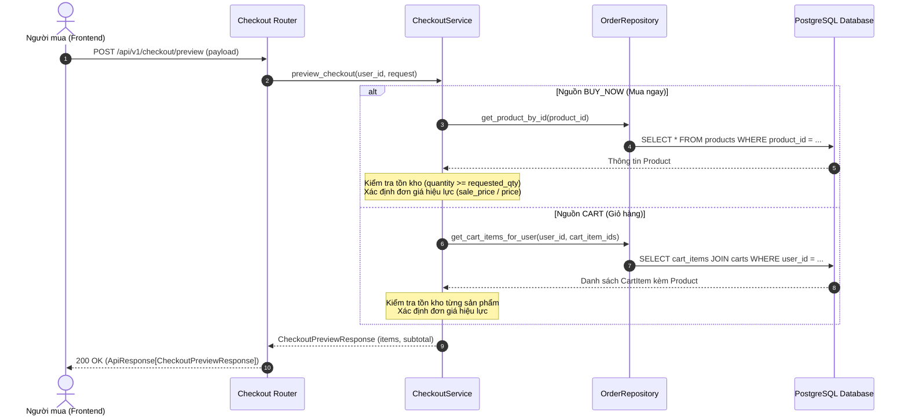

# Tài liệu Kỹ thuật: Phân hệ Checkout (Stateless Preview & Reorder)

Tài liệu này mô tả chi tiết kiến trúc, luồng xử lý nghiệp vụ, các ràng buộc kỹ thuật, cùng danh sách các API đầu vào/đầu ra đã được triển khai trong mã nguồn thực tế của phân hệ Checkout (`src/app/modules/orders`).

---

## 1. Tổng quan Kiến trúc

Phân hệ Checkout được thiết kế theo nguyên lý **Stateless Preview**:
* **Không lưu trạng thái phiên checkout vào Database hay Redis:** Server không duy trì draft order hoặc session checkout tạm thời nhằm tránh rác dữ liệu, deadlock và giải phóng bộ nhớ.
* **Tính toán thời gian thực (Real-time Evaluation):** Tại mỗi thời điểm preview, server trực tiếp truy xuất Database để lấy đơn giá mới nhất (áp dụng giá khuyến mãi nếu có) và kiểm tra số lượng tồn kho khả dụng.
* **Tạo Snapshot cho Client:** Kết quả preview trả về một snapshot chi tiết từng mặt hàng và tổng tiền dự kiến. Snapshot này là cơ sở bắt buộc để đối chiếu khi Client gửi request tạo đơn hàng chính thức (`POST /api/v1/orders`).
* **Hỗ trợ Reorder (Mua lại từ đơn cũ):** Cho phép nạp toàn bộ danh sách sản phẩm từ một đơn hàng đã hoàn tất trong quá khứ để tạo thành một snapshot checkout mới theo đơn giá và tồn kho hiện tại.

---

## 2. Luồng Xử lý Nghiệp vụ



---

## 3. Các Quy tắc & Ràng buộc Nghiệp vụ (Business Rules)

### 3.1. Quy tắc Xác định Đơn giá Hiệu lực (`_determine_effective_price`)
Hệ thống ưu tiên đơn giá khuyến mãi nếu còn hiệu lực:
$$\text{effective\_price} = \begin{cases} \text{product.sale\_price} & \text{nếu } \text{sale\_price} > 0 \\ \text{product.price} & \text{ngược lại} \end{cases}$$

### 3.2. Quy tắc Kiểm tra Tồn kho (Stock Availability)
* Nếu `product.quantity < requested_quantity`, hệ thống từ chối ngay lập tức bằng lỗi:
  * **HTTP Status:** `409 Conflict`
  * **Error Code:** `INSUFFICIENT_STOCK`
  * **Thông báo:** Nêu rõ số lượng còn lại trong kho và số lượng yêu cầu.

### 3.3. Ràng buộc Nguồn dữ liệu (Validation Rules)
* **Khi `checkout_type = BUY_NOW`:**
  * Bắt buộc phải có `buy_now_item`.
  * `product_id >= 1`, `quantity >= 1`.
  * Nếu thiếu hoặc vi phạm -> lỗi `422 Unprocessable Entity` (Pydantic model validator) hoặc `400 Bad Request`.
* **Khi `checkout_type = CART`:**
  * Bắt buộc `cart_item_ids` là danh sách không được rỗng.
  * Tất cả `cart_item_id` phải là số nguyên dương (`> 0`).
  * **Bảo mật quyền sở hữu giỏ hàng:** Chỉ truy vấn các `cart_item` thuộc về `user_id` hiện tại (`Cart.user_id == current_user_id`). Nếu client gửi `cart_item_id` của người khác hoặc không tồn tại -> lỗi `404 Not Found` (`Sản phẩm trong giỏ hàng`).

### 3.4. Ràng buộc Mua lại đơn hàng cũ (`reorder`)
* Phải kiểm tra quyền sở hữu đơn hàng: `past_order = repo.get_order_by_id(order_id, user_id=user_id)`. Nếu không tồn tại hoặc của user khác -> `404 Not Found`.
* Đơn hàng cũ phải có ít nhất 1 sản phẩm (`past_order.order_details` không rỗng).
* Toàn bộ sản phẩm trong đơn cũ được kiểm tra lại tồn kho và cập nhật đơn giá theo giá Database hiện tại (không lấy giá cũ lúc mua trong quá khứ).

---

## 4. Danh sách API Endpoints

### 4.1. Tạo Snapshot Checkout (Preview)
* **Method & Path:** `POST /api/v1/checkout/preview`
* **Authentication:** Bắt buộc (Bearer JWT Token)
* **Mô tả:** Kiểm tra tồn kho, đơn giá Database và trả về snapshot preview.

#### Request Body (`CheckoutPreviewRequest`):
```json
// Trường hợp 1: Mua ngay (BUY_NOW)
{
  "checkout_type": "BUY_NOW",
  "buy_now_item": {
    "product_id": 101,
    "quantity": 2
  },
  "cart_item_ids": null
}

// Trường hợp 2: Thanh toán từ giỏ hàng (CART)
{
  "checkout_type": "CART",
  "buy_now_item": null,
  "cart_item_ids": [12, 15]
}
```

#### Response Body (200 OK - `ApiResponse[CheckoutPreviewResponse]`):
```json
{
  "success": true,
  "message": "Tạo snapshot checkout thành công",
  "data": {
    "items": [
      {
        "product_id": 101,
        "product_name": "Áo Thun Nam Cotton Thấm Hút Mồ Hôi",
        "product_image": "https://example.com/images/shirt.jpg",
        "price": "250000.00",
        "quantity": 2,
        "total_price": "500000.00"
      }
    ],
    "subtotal": "500000.00"
  },
  "error": null
}
```

---

### 4.2. Khởi tạo Snapshot mua lại từ Đơn hàng cũ (Reorder)
* **Method & Path:** `POST /api/v1/orders/{order_id}/reorder`
* **Authentication:** Bắt buộc (Bearer JWT Token)
* **Mô tả:** Nạp các sản phẩm trong đơn hàng `order_id` cũ, kiểm tra tồn kho và lấy giá hiện hành để trả về `CheckoutPreviewResponse`.

#### Path Parameters:
* `order_id` (string, required): Mã đơn hàng cũ (ví dụ: `OD20261026ABC123`).

#### Response Body (200 OK - `ApiResponse[CheckoutPreviewResponse]`):
* Cấu trúc trả về giống hệt API preview, phản ánh đúng giá và tồn kho tại thời điểm reorder.

---

## 5. Bảng Mã Lỗi Thường Gặp (Error Reference)

| HTTP Status | Error Code | Lý do xảy ra | Cách khắc phục từ Client |
| :--- | :--- | :--- | :--- |
| **400 Bad Request** | `BAD_REQUEST` | Thiếu `buy_now_item` khi `BUY_NOW` hoặc mảng `cart_item_ids` rỗng | Kiểm tra đúng payload theo `checkout_type` |
| **404 Not Found** | `NOT_FOUND` | Sản phẩm hoặc `cart_item_id` không tồn tại hoặc không thuộc quyền sở hữu | Làm mới giỏ hàng hoặc chọn lại sản phẩm |
| **409 Conflict** | `INSUFFICIENT_STOCK` | Số lượng tồn kho Database nhỏ hơn số lượng muốn đặt | Giảm số lượng mua hoặc chọn sản phẩm khác |
| **422 Unprocessable** | `VALIDATION_ERROR` | Định dạng dữ liệu không khớp Pydantic schema | Truyền đúng schema, số nguyên dương cho id/qty |

