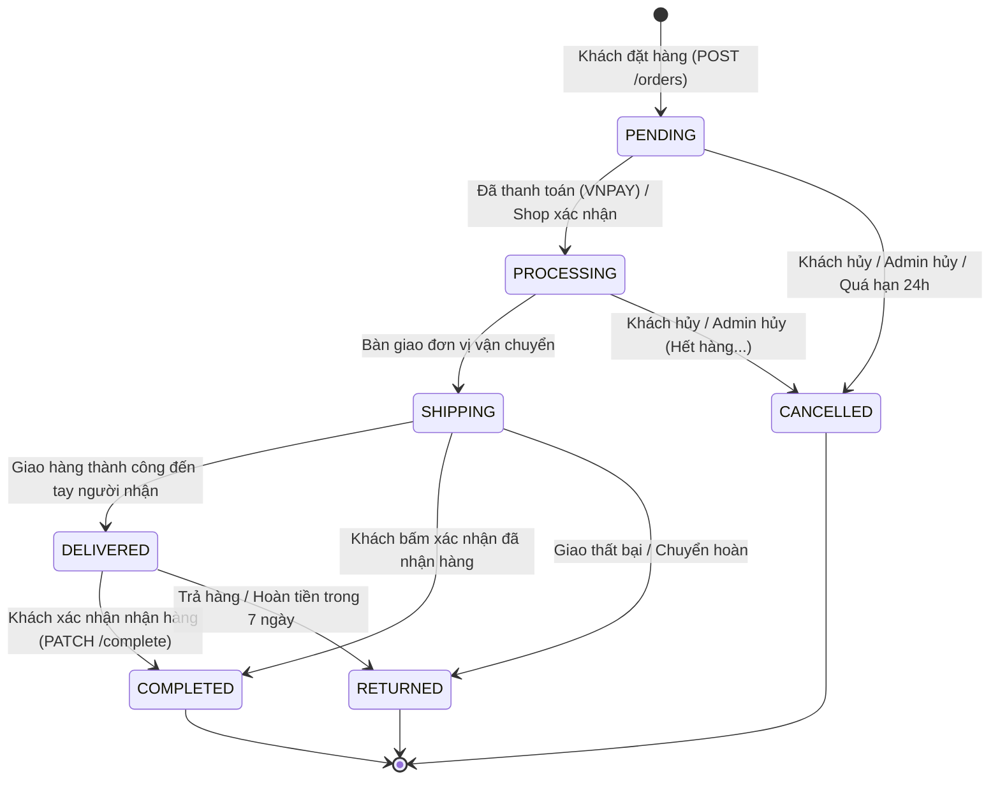
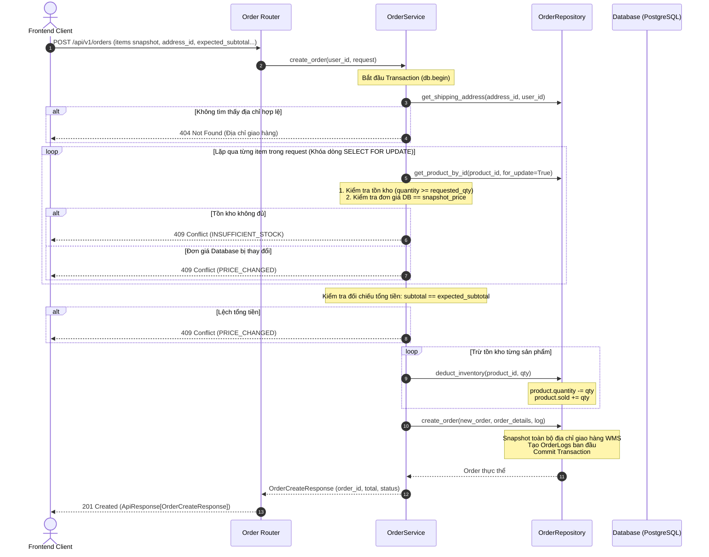

# Tài liệu Kỹ thuật: Phân hệ Quản lý Đơn hàng (Order Lifecycle & Management)

Tài liệu này mô tả chi tiết toàn bộ vòng đời của đơn hàng, các quy tắc nghiệp vụ, cấu trúc dữ liệu, và các API đầu vào/đầu ra đã được lập trình trong phân hệ Orders (`src/app/modules/orders`).

---

## 1. Vòng đời Trạng thái Đơn hàng (Order State Machine)

Hệ thống quản lý trạng thái đơn hàng theo máy trạng thái hữu hạn (Finite State Machine) nghiêm ngặt nhằm đảm bảo tính toàn vẹn dữ liệu:



### Chi tiết các trạng thái (`OrderStatus`):
* `PENDING`: Đơn hàng mới tạo, đang chờ thanh toán (nếu là VNPAY) hoặc chờ shop duyệt.
* `PROCESSING`: Đang chuẩn bị hàng tại kho, đóng gói kiện hàng.
* `SHIPPING`: Đã bàn giao cho đối tác vận chuyển, đang trên đường giao.
* `DELIVERED`: Shipper đã phát hàng thành công đến địa chỉ người nhận.
* `COMPLETED`: Khách hàng bấm xác nhận hoàn tất hoặc hệ thống tự động hoàn tất sau thời gian chờ.
* `CANCELLED`: Đơn hàng bị hủy (bởi Khách hàng, Quản trị viên hoặc Hệ thống). Tồn kho bắt buộc được hoàn trả.
* `RETURNED`: Đơn hàng trả lại do lỗi hoặc khiếu nại.

---

## 2. Luồng Nghiệp vụ Trọng yếu

### 2.1. Tạo Đơn hàng Mới (`POST /api/v1/orders`)

Quá trình tạo đơn hàng áp dụng cơ chế **Atomic Transaction** và **Optimistic Locking**:



#### Các chốt chặn an toàn khi tạo đơn:
1. **Chống giả mạo giá (Tamper-proofing):** Server so sánh đơn giá client gửi lên với đơn giá thực tế đang có trong DB (`effective_price = sale_price or price`). Nếu có chênh lệch, trả về lỗi `409 Conflict` kèm thông tin chi tiết.
2. **Khóa bản ghi chống Race Condition (`for_update=True`):** Khi nhiều người cùng đặt món hàng cuối cùng trong kho, câu lệnh khóa bản ghi đảm bảo chỉ người đến trước trừ được kho.
3. **Snapshot địa chỉ giao hàng WMS:** Lưu bản sao cứng các trường: `shipping_recipient_name`, `shipping_phone`, `shipping_province_code`, `shipping_province_name`, `shipping_ward_code`, `shipping_ward_name`, `shipping_address_line`. Việc sửa địa chỉ trong sổ địa chỉ người dùng sau này sẽ không làm sai lệch đơn hàng đã chốt.
4. **Quy tắc tính cước vận chuyển chuẩn:** Mặc định cước phí giao hàng cố định là `30,000 VND`. Tổng đơn hàng:
   $$\text{total} = \text{subtotal} + \text{shipping\_fee}$$
5. **Mã đơn hàng độc nhất (`_generate_order_id`):** Kết hợp định dạng thời gian và chuỗi ngẫu nhiên hexadecimal, ví dụ `OD240326A1B2C3`.

---

### 2.2. Khách hàng Hủy Đơn Hàng (`PATCH /api/v1/orders/{order_id}/cancel`)

#### Điều kiện cho phép hủy:
* Đơn hàng thuộc quyền sở hữu của `user_id`.
* Trạng thái đơn hàng phải là `PENDING` hoặc `PROCESSING`. Nếu đơn đã ở `SHIPPING`, `DELIVERED`, `COMPLETED`, `CANCELLED` -> từ chối bằng `409 Conflict` (`INVALID_ORDER_STATE`).
* Trạng thái thanh toán phải **chưa thanh toán thành công** (`order.payment_status != PAID`). Đơn đã thanh toán online không được hủy trực tiếp từ phía client để chống gian lận và phải liên hệ CSKH.

#### Xử lý hủy đơn và hoàn trả kho:
1. **Hoàn tồn kho tự động (`restore_inventory`):**
   ```python
   product.quantity += item.quantity
   product.sold = max(0, product.sold - item.quantity)
   ```
2. **Chuẩn hóa lý do hủy qua Reason Catalog:**
   * Hỗ trợ các mã chuẩn `CustomerCancelReason`:
     * `CHANGE_OF_MIND`: Đổi ý / Không còn nhu cầu mua nữa
     * `CHANGE_SHIPPING_ADDRESS`: Muốn đổi địa chỉ nhận hàng hoặc SĐT
     * `FOUND_BETTER_PRICE`: Tìm thấy nơi khác giá tốt hơn
     * `CHANGE_PAYMENT_METHOD`: Muốn đổi phương thức thanh toán
     * `OTHER`: Lý do khác (Bắt buộc phải nhập kèm `custom_reason`)
3. **Cập nhật thông tin Audit:**
   * `order.status = CANCELLED`
   * `order.cancel_reason`: Lưu chuỗi hiển thị gọn gàng cho Frontend.
   * `order.cancelled_by_type = CancelledByType.CUSTOMER`
   * `order.cancelled_by_id = user_id`
   * `order.cancelled_at = datetime.now(UTC)`
   * Ghi log chi tiết vào bảng `order_logs`.

---

### 2.3. Quản trị viên Hủy Đơn Hàng (`PATCH /api/v1/admin/orders/{order_id}/cancel`)

* **Phân quyền:** Yêu cầu quyền `ADMIN` hoặc `STAFF`.
* **Catalog lý do quản trị (`AdminCancelReason`):**
  * `OUT_OF_STOCK`: Hết hàng trong kho
  * `WRONG_PRICE_OR_INFO`: Sai thông tin giá hoặc mô tả sản phẩm
  * `CUSTOMER_REQUESTED`: Khách hàng liên hệ tổng đài nhờ hủy hộ
  * `SUSPICIOUS_ORDER`: Đơn hàng nghi ngờ gian lận / đơn ảo
  * `OTHER`: Lý do khác (bắt buộc kèm `custom_reason`)
* Tự động hoàn trả tồn kho và lưu audit log với `cancelled_by_type = STAFF / ADMIN`.

---

### 2.4. Khách hàng Xác nhận Hoàn thành (`PATCH /api/v1/orders/{order_id}/complete`)

* Chỉ áp dụng khi đơn hàng đang ở trạng thái `DELIVERED` hoặc `SHIPPING`.
* Cập nhật `order.status = COMPLETED`, gán `order.delivered_at = now` và ghi nhận lịch sử vào `order_logs`.

---

## 3. Danh mục API Endpoints Đơn Hàng

| Phương thức | Đường dẫn | Phân quyền | Mục đích |
| :--- | :--- | :--- | :--- |
| `POST` | `/api/v1/orders` | Khách hàng | Tạo đơn hàng mới từ snapshot checkout |
| `GET` | `/api/v1/orders` | Khách hàng | Xem lịch sử đơn hàng (phân trang, lọc status, search) |
| `GET` | `/api/v1/orders/{order_id}` | Khách hàng | Xem chi tiết đơn hàng, snapshot địa chỉ, logs |
| `PATCH` | `/api/v1/orders/{order_id}/complete` | Khách hàng | Xác nhận đã nhận hàng thành công |
| `PATCH` | `/api/v1/orders/{order_id}/cancel` | Khách hàng | Khách hủy đơn hàng kèm lý do chuẩn |
| `GET` | `/api/v1/orders/cancellation-reasons` | Public/Auth | Lấy danh mục lý do hủy đơn cho khách |
| `GET` | `/api/v1/admin/orders/cancellation-reasons` | Admin/Staff | Lấy danh mục lý do hủy đơn cho quản trị |
| `PATCH` | `/api/v1/admin/orders/{order_id}/cancel` | Admin/Staff | Quản trị viên / Shop hủy đơn hàng |

---

## 4. Đặc tả Dữ liệu Đầu vào & Đầu ra Chi tiết

### 4.1. Tạo Đơn Hàng (`POST /api/v1/orders`)

#### Request Body (`CreateOrderRequest`):
```json
{
  "items": [
    {
      "product_id": 101,
      "quantity": 2,
      "price": "250000.00"
    }
  ],
  "expected_subtotal": "500000.00",
  "address_id": 15,
  "payment_method": "COD",
  "note": "Giao giờ hành chính, gọi trước 15 phút"
}
```

#### Response Body (201 Created - `ApiResponse[OrderCreateResponse]`):
```json
{
  "success": true,
  "message": "Tạo đơn hàng thành công",
  "data": {
    "order_id": "OD24102601AF98",
    "payment_method": "COD",
    "total": "530000.00",
    "status": "PENDING"
  },
  "error": null
}
```

---

### 4.2. Lấy Danh Sách Lịch Sử Đơn Hàng (`GET /api/v1/orders`)

#### Query Parameters:
* `orderStatus` (optional): Lọc theo trạng thái (`PENDING`, `PROCESSING`, `SHIPPING`, `DELIVERED`, `COMPLETED`, `CANCELLED`, `RETURNED`).
* `search` (optional): Tìm kiếm theo mã đơn hàng hoặc tên sản phẩm bên trong đơn.
* `page` (optional, default: 1): Số trang (bắt đầu từ 1).
* `page_size` (optional, default: 10, max: 100): Kích thước trang.

#### Response Body (200 OK - `ApiResponse[PaginatedResponse[OrderSummaryResponse]]`):
```json
{
  "success": true,
  "message": "Lấy danh sách đơn hàng thành công",
  "data": {
    "items": [
      {
        "order_id": "OD24102601AF98",
        "status": "PENDING",
        "payment_status": "PENDING",
        "payment_method": "COD",
        "total": "530000.00",
        "total_items": 2,
        "created_at": "2026-10-26T14:30:00Z",
        "cancel_reason": null,
        "cancelled_by_type": null,
        "cancelled_at": null,
        "items": [
          {
            "product_id": 101,
            "product_name": "Áo Thun Nam Cotton Thấm Hút Mồ Hôi",
            "product_image": "https://example.com/images/shirt.jpg",
            "quantity": 2,
            "price": "250000.00",
            "total_price": "500000.00"
          }
        ]
      }
    ],
    "total": 1,
    "page": 1,
    "page_size": 10,
    "total_pages": 1
  },
  "error": null
}
```

---

### 4.3. Khách Hàng Hủy Đơn Hàng (`PATCH /api/v1/orders/{order_id}/cancel`)

#### Request Body (`CancelOrderRequest`):
```json
// Trường hợp chọn lý do có sẵn
{
  "reason_code": "CHANGE_OF_MIND",
  "custom_reason": null
}

// Trường hợp chọn lý do khác (Bắt buộc kèm custom_reason)
{
  "reason_code": "OTHER",
  "custom_reason": "Tôi đặt nhầm kích cỡ sản phẩm và muốn đặt lại"
}
```

#### Response Body (200 OK - `ApiResponse[OrderActionResponse]`):
```json
{
  "success": true,
  "message": "Hủy đơn hàng thành công",
  "data": {
    "order_id": "OD24102601AF98",
    "status": "CANCELLED",
    "message": "Hủy đơn hàng thành công và hệ thống đã tự động hoàn trả tồn kho tương ứng.",
    "cancel_reason": "Lý do khác: Tôi đặt nhầm kích cỡ sản phẩm và muốn đặt lại",
    "cancelled_by_type": "CUSTOMER",
    "cancelled_at": "2026-10-26T14:35:10Z"
  },
  "error": null
}
```

