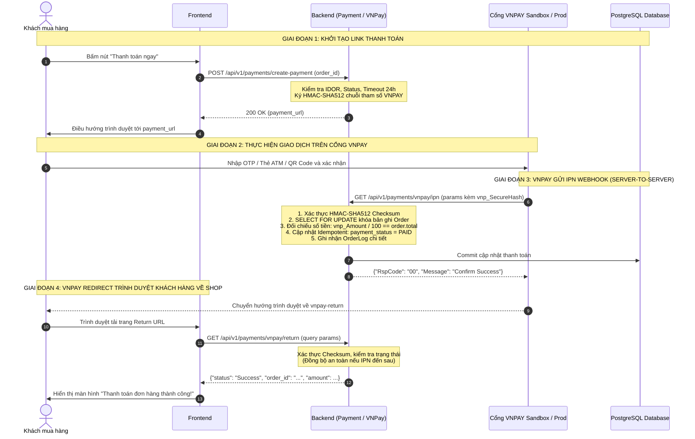

# Tài liệu Kỹ thuật: Phân hệ Thanh toán (Payment Management & VNPay Integration)

Tài liệu này mô tả chi tiết kiến trúc điều phối thanh toán, các ràng buộc an toàn, cùng quy trình tích hợp cổng thanh toán trực tuyến VNPAY và phương thức COD trong hệ thống (`src/app/modules/payments`).

---

## 1. Tổng quan Kiến trúc Thanh toán

Phân hệ thanh toán được chia làm 2 tầng rõ ràng:
1. **Tầng Điều phối Nghiệp vụ (`PaymentService`):**
   * Đóng vai trò Facade kiểm soát nghiệp vụ thanh toán tổng thể giữa Orders và các Cổng thanh toán.
   * Chịu trách nhiệm thẩm định quyền sở hữu (IDOR), tính hợp lệ của đơn hàng, trạng thái thanh toán và kiểm soát thời hạn thanh toán (24h Payment Timeout).
2. **Tầng Tích hợp Cổng (`VNPayService`):**
   * Chịu trách nhiệm mã hóa kỹ thuật, sinh chữ ký số SHA-512 (HMAC), điều hướng Payment URL, xác thực tính toàn vẹn (Checksum) và xử lý Webhook (IPN/Return URL) an toàn, idempotent.

```
                  +-----------------------------------+
                  |          Client Request           |
                  +-----------------------------------+
                                    |
                                    v
                  +-----------------------------------+
                  |       POST /create-payment        |
                  +-----------------------------------+
                                    |
                  +-----------------------------------+
                  |          PaymentService           |
                  |  - Check quyền sở hữu (IDOR)      |
                  |  - Check trạng thái Order/Payment |
                  |  - Check Timeout 24h & Hoàn kho   |
                  +-----------------------------------+
                         /                     \
                        / (VNPAY)               \ (COD)
                       v                         v
       +-----------------------+     +------------------------+
       |     VNPayService      |     |  Xác nhận thành công   |
       | - HMAC-SHA512 Sign    |     |  payment_url = null    |
       | - Sinh URL thanh toán |     +------------------------+
       +-----------------------+
```

---

## 2. Các Ràng buộc & Chốt chặn An toàn (`create_payment`)

Khi client gọi API `POST /api/v1/payments/create-payment`, hệ thống thực thi 6 bước kiểm tra nghiêm ngặt:

### 2.1. Kiểm tra Quyền sở hữu (Anti-IDOR)
* Truy vấn đơn hàng từ Database theo `request.order_id`.
* Bắt buộc `order.user_id == current_user_id`. Nếu vi phạm -> ném `403 Forbidden` (`Bạn không có quyền thực hiện thanh toán cho đơn hàng này`).

### 2.2. Kiểm tra Trạng thái Đơn hàng (Order Status Constraint)
* Đơn hàng chỉ được phép tạo thanh toán khi ở trạng thái **`PENDING`** (Chờ xử lý / Chờ thanh toán).
* Hệ thống trả về mã lỗi riêng biệt để đảm bảo tính tương thích ngược cho Client/Frontend:
  * Nếu `order.status == CANCELLED` -> ném `400 Bad Request` với error code **`ORDER_CANCELLED`**.
  * Nếu `order.status == COMPLETED` -> ném `400 Bad Request` với error code **`ORDER_COMPLETED`**.
  * Nếu `order.status` thuộc bất kỳ trạng thái nào khác (`SHIPPING`, `DELIVERED`, `PROCESSING`, `RETURNED`) -> ném `400 Bad Request` với error code **`INVALID_ORDER_STATUS_FOR_PAYMENT`**.

### 2.3. Kiểm tra Trạng thái Thanh toán (Payment Status Constraint)
* `order.payment_status == PAID` -> ném `400 Bad Request` với error code **`ORDER_ALREADY_PAID`**.
* `order.payment_status == REFUNDED` -> ném `400 Bad Request` với error code **`ORDER_REFUNDED`**.
* Nếu trạng thái là `FAILED` hoặc `PENDING`, hệ thống cho phép tạo lại link thanh toán (Retry Payment).

### 2.4. Kiểm tra Thời hạn Thanh toán Online (24h Timeout) & Tự động Hoàn kho
* **Phạm vi áp dụng:** Chỉ áp dụng cho thanh toán trực tuyến (`VNPAY`), **không áp dụng cho COD** (vì đơn COD thanh toán khi shipper giao hàng).
* **Xử lý An toàn Múi giờ (Timezone-safe):** Tự động chuyển đổi sang múi giờ `UTC` nếu `order.order_date` là naive datetime, ngăn chặn lỗi `TypeError: can't subtract offset-naive and offset-aware datetimes`.
* **Khi quá 24 giờ:**
  1. **Hoàn trả tồn kho (`self.order_repo.restore_inventory(order=order)`):** Cộng lại số lượng sản phẩm vào kho (`product.quantity += item.qty`) và giảm số lượng đã bán (`product.sold -= item.qty`).
  2. **Ghi nhận Hủy đơn chuẩn SYSTEM (`cancel_order_record`):** Cập nhật `order.status = CANCELLED`, `cancel_reason = "Hủy đơn hàng tự động do quá thời hạn thanh toán 24h"`, `cancelled_by_type = "SYSTEM"`, `cancelled_at = now`.
  3. **Từ chối giao dịch:** Ném `400 Bad Request` với error code **`PAYMENT_EXPIRED`**.

---

## 3. Luồng Tích hợp Cổng Thanh toán VNPAY

### 3.1. Sơ đồ Tuần tự Toàn diện



---

## 4. Chi tiết Kỹ thuật Cổng VNPAY

### 4.1. Thuật toán Ký số (HMAC-SHA512 Checksum)
Toàn bộ tham số gửi sang VNPAY hoặc nhận về từ VNPAY đều được chuẩn hóa và ký số:
1. Loại bỏ các tham số rỗng (`None`) và tham số `vnp_SecureHash`, `vnp_SecureHashType`.
2. Sắp xếp các tham số theo thứ tự alphabet của `key`.
3. Nối thành chuỗi truy vấn định dạng `key1=val1&key2=val2` (áp dụng mã hóa URL `quote_plus`).
4. Băm HMAC với thuật toán `hashlib.sha512` và bí mật `settings.VNP_HASH_SECRET`.

### 4.2. Mã tham chiếu giao dịch độc nhất (`vnp_TxnRef`)
Để tránh lỗi trùng mã tham chiếu giao dịch trên VNPAY khi khách thanh toán thất bại và ấn "Thử lại":
$$\text{txn\_ref} = \text{order.order\_id} + \text{"\_"} + \text{str}(\text{int}(\text{time.time}()))$$
Khi nhận IPN hoặc Return URL, hệ thống tách chuỗi:
$$\text{order\_id} = \text{txn\_ref}.\text{split}(\text{"\_"})[0]$$

### 4.3. Thời hạn URL Thanh toán (`vnp_ExpireDate`)
Thời gian khởi tạo (`vnp_CreateDate`) và thời gian hết hạn (`vnp_ExpireDate`) được tính toán theo múi giờ Việt Nam (`Asia/Ho_Chi_Minh`):
* Thời hạn hiệu lực của URL chuyển hướng: **15 phút** kể từ thời điểm sinh link.

### 4.4. Cơ chế Khóa dòng Chống Race Condition & Idempotency
* Khi nhận IPN Webhook hoặc Return URL, server truy vấn đơn hàng với **`for_update=True`** (tương đương `SELECT ... FOR UPDATE` trong PostgreSQL).
* **Cập nhật Idempotent (`_mark_payment_success`):**
  ```python
  if order.payment_status == PaymentStatus.PAID.value:
      return False  # Đã ghi nhận PAID trước đó (bởi IPN hoặc Return URL), bỏ qua không ghi đè
  ```
  Nhờ đó, dù IPN và Return URL gọi đồng thời, dữ liệu và lịch sử log đơn hàng chỉ được ghi nhận chính xác 1 lần duy nhất.

---

## 5. Danh mục API Endpoints Thanh toán

### 5.1. Khởi tạo Thanh toán (`POST /api/v1/payments/create-payment`)
* **Authentication:** Bắt buộc (Bearer JWT Token)

#### Request Body (`CreatePaymentRequest`):
```json
{
  "order_id": "OD24102601AF98"
}
```

#### Response Body khi chọn VNPAY (200 OK - `CreatePaymentResponse`):
```json
{
  "success": true,
  "message": "Khởi tạo link thanh toán VNPAY thành công",
  "data": {
    "order_id": "OD24102601AF98",
    "payment_method": "VNPAY",
    "amount": "530000.00",
    "payment_url": "https://sandbox.vnpayment.vn/paymentv2/vpcpay.html?vnp_Amount=53000000&vnp_Command=pay&vnp_CreateDate=20261026143000&vnp_CurrCode=VND&vnp_ExpireDate=20261026144500&vnp_IpAddr=127.0.0.1&vnp_Locale=vn&vnp_OrderInfo=Thanh+toan+don+hang+OD24102601AF98&vnp_OrderType=other&vnp_ReturnUrl=http%3A%2F%2Flocalhost%3A5173%2Fcheckout%2Fvnpay-return&vnp_TmnCode=TESTTMN&vnp_TxnRef=OD24102601AF98_1729953000&vnp_Version=2.1.0&vnp_SecureHash=a9b8c7...",
    "message": "Khởi tạo link thanh toán VNPAY thành công"
  },
  "error": null
}
```

#### Response Body khi chọn COD (200 OK - `CreatePaymentResponse`):
```json
{
  "success": true,
  "message": "Đơn hàng áp dụng phương thức thanh toán khi nhận hàng (COD)",
  "data": {
    "order_id": "OD24102601AF98",
    "payment_method": "COD",
    "amount": "530000.00",
    "payment_url": null,
    "message": "Đơn hàng áp dụng phương thức thanh toán khi nhận hàng (COD)"
  },
  "error": null
}
```

---

### 5.2. Xử lý IPN Webhook (`GET /api/v1/payments/vnpay/ipn`)
* **Mục đích:** VNPAY Server gọi tự động tới Backend khi giao dịch hoàn tất.
* **Định dạng phản hồi:** JSON theo chuẩn VNPAY IPN Specification.

#### Bảng Mã phản hồi IPN (`RspCode`):
| RspCode | Message | Mô tả |
| :--- | :--- | :--- |
| **00** | `Confirm Success` | Ghi nhận thanh toán thành công |
| **97** | `Invalid Checksum` | Sai chữ ký bảo mật SHA-512 |
| **01** | `Order not found` | Không tìm thấy mã đơn hàng trong Database |
| **02** | `Order already confirmed` | Đơn hàng đã được xác nhận thanh toán trước đó |
| **04** | `Invalid Amount` | Số tiền thanh toán không khớp tổng tiền đơn hàng |
| **99** | `Database connection not initialized` | Lỗi kết nối cơ sở dữ liệu nội bộ |

---

### 5.3. Xác thực Trả về Trình duyệt (`GET /api/v1/payments/vnpay/return`)
* **Mục đích:** Frontend gọi sau khi khách hàng được VNPAY redirect về lại trang web.
* **Tham số:** Toàn bộ query params VNPAY gửi về (`vnp_Amount`, `vnp_ResponseCode`, `vnp_TxnRef`, `vnp_SecureHash`...).

#### Response Body (200 OK):
```json
{
  "success": true,
  "message": "Xác thực kết quả thanh toán VNPay thành công",
  "data": {
    "status": "Success",
    "order_id": "OD24102601AF98",
    "amount": 530000.0,
    "response_code": "00"
  },
  "error": null
}
```

---

## 6. Bảng Mã Lỗi Thanh Toán Hệ Thống (Payment Error Codes)

| HTTP Status | Error Code | Lý do xảy ra |
| :--- | :--- | :--- |
| **403 Forbidden** | `FORBIDDEN` | Người dùng cố gắng thanh toán đơn hàng của người khác (IDOR) |
| **400 Bad Request** | `ORDER_CANCELLED` | Đơn hàng đã bị hủy, không cho phép thanh toán |
| **400 Bad Request** | `ORDER_COMPLETED` | Đơn hàng đã hoàn tất trước đó |
| **400 Bad Request** | `INVALID_ORDER_STATUS_FOR_PAYMENT` | Đơn hàng không ở trạng thái PENDING |
| **400 Bad Request** | `ORDER_ALREADY_PAID` | Đơn hàng đã được thanh toán thành công trước đó |
| **400 Bad Request** | `ORDER_REFUNDED` | Đơn hàng đã hoàn tiền, không thể thanh toán lại |
| **400 Bad Request** | `PAYMENT_EXPIRED` | Đơn hàng online quá 24h chưa thanh toán (tự động hoàn kho & hủy đơn) |
| **400 Bad Request** | `UNSUPPORTED_PAYMENT_METHOD` | Phương thức thanh toán chưa được hỗ trợ trên hệ thống |
| **400 Bad Request** | `INVALID_VNPAY_CHECKSUM` | Sai chữ ký checksum SHA-512 từ cổng thanh toán VNPAY |

