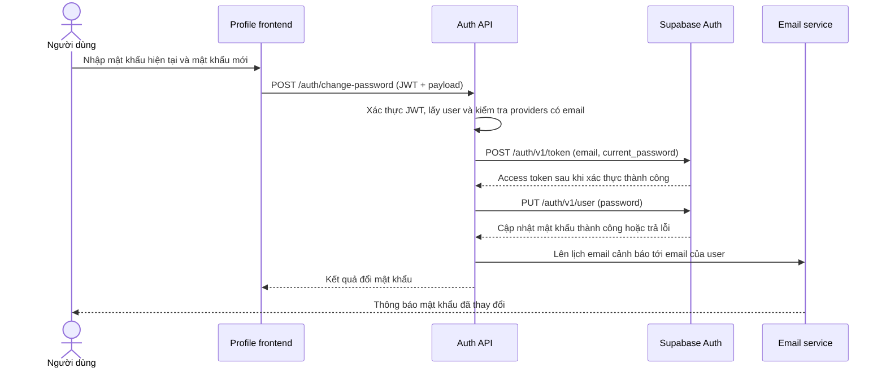

# Kế hoạch 2: Đổi mật khẩu trong hồ sơ và thông báo qua email

## Mục tiêu

Cho phép người dùng đã đăng nhập đổi mật khẩu từ trang hồ sơ cá nhân. Chức năng chỉ dành cho tài khoản dùng đăng nhập email/mật khẩu của Supabase. Sau khi đổi thành công, gửi email cảnh báo tới địa chỉ email hiện lưu trên tài khoản.

## Hiện trạng liên quan

- `users.provider` đã có trong model để lưu provider gốc. Supabase quy định `app_metadata.provider` là provider đầu tiên user đăng ký; `app_metadata.providers` là danh sách provider user có thể dùng để đăng nhập.
- Frontend gửi người dùng Google qua Supabase OAuth. Route callback đổi authorization code thành session rồi gọi `POST /auth/sync` kèm access token.
- Backend lấy `app_metadata.provider` từ JWT và truyền vào `AuthService.sync_user`. Provider gốc được ghi vào cột `users.provider`.
- Trước triển khai, `sync_user` không cập nhật provider user đã tồn tại và router mặc định provider thiếu thành `EMAIL`. Phần triển khai đồng bộ này đã sửa để không phân loại nhầm provider không xác định.
- Profile frontend đã có thẻ thông tin cá nhân và các modal chỉnh sửa profile/avatar; auth module đã tích hợp Supabase và dịch vụ email Jinja/SMTP.

## Thiết kế đề xuất

### Backend: đồng bộ và kiểm tra provider

1. Lấy provider gốc từ claim `app_metadata.provider` trong JWT đã xác thực, chuẩn hóa về chữ hoa trước khi lưu.
2. Khi `/auth/sync` gặp user đã có, cập nhật provider gốc nếu claim có giá trị và khác với dữ liệu hiện tại. Không tự gán `EMAIL` khi claim vắng mặt.
3. Endpoint đổi mật khẩu kiểm tra danh sách `app_metadata.providers` trong JWT đã xác thực; cho phép nếu danh sách có `email`, bất kể lần đăng nhập hiện tại là Google hay email. Dự phòng `app_metadata.provider == email` nếu claim danh sách vắng mặt. Không có provider email hoặc provider không xác định thì từ chối.
4. `/auth/me` trả danh sách provider đã xác thực từ JWT để frontend quyết định hiển thị chức năng. Không cần migration: cột `users.provider` hiện tại tiếp tục lưu provider gốc, còn danh sách phương thức đăng nhập lấy trực tiếp từ claim Supabase.

### Backend: API đổi mật khẩu

- Thêm `POST /auth/change-password`, yêu cầu JWT hợp lệ; `/auth/me` trả danh sách `providers` từ claim JWT đã xác thực để profile quyết định hiển thị mục đổi mật khẩu.
- Payload: `current_password`, `new_password`; quy tắc mật khẩu mới thống nhất với reset-password hiện có (6–64 ký tự), không chấp nhận mật khẩu mới trùng mật khẩu hiện tại.
- Backend lấy application user đã xác thực, kiểm tra tài khoản có provider email/password và có email nhận cảnh báo. Backend gọi Supabase Auth `POST /auth/v1/token?grant_type=password` với email trong database và mật khẩu hiện tại; chỉ tiếp tục nếu Supabase xác thực thành công và user ID trả về khớp tài khoản đang đăng nhập. Sau đó dùng access token vừa xác minh gọi `PUT /auth/v1/user` để cập nhật mật khẩu mới. Session hiện tại có thể là session Google nếu tài khoản đã liên kết email/password.
- Không phụ thuộc tùy chọn **Require current password when changing password** vì backend xác thực mật khẩu hiện tại tường minh. Lỗi xác thực và lỗi chính sách mật khẩu được chuyển thành thông báo phù hợp; không ghi mật khẩu hoặc token vào log.
- Trả kết quả thành công sau khi Supabase cập nhật mật khẩu. Không lưu mật khẩu trong application database.

### Email cảnh báo

- Thêm `send_password_changed` vào `IEmailSender` và `GmailSmtpEmailSender`.
- Thêm template `password_changed.html`, kế thừa `base.html`, thông báo thời gian đổi và hướng dẫn liên hệ hỗ trợ/khôi phục tài khoản nếu người nhận không thực hiện.
- Backend gửi tới email đã xác thực từ user trong database, không nhận địa chỉ nhận mail từ request.
- Gửi bằng FastAPI `BackgroundTasks`, chỉ sau khi Supabase xác nhận đổi thành công. Nếu SMTP lỗi, ghi log; không báo đổi mật khẩu thất bại hoặc hoàn tác cập nhật đã thành công.
- Email không chứa mật khẩu, recovery token hay access token.

### Frontend: profile

- Thêm mục bảo mật/đổi mật khẩu vào profile, phù hợp với layout và semantic color token hiện tại.
- Tạo form gồm mật khẩu hiện tại, mật khẩu mới, xác nhận mật khẩu mới; có hiện/ẩn mật khẩu, kiểm tra tại client, lỗi cạnh trường, trạng thái đang gửi và thông báo kết quả.
- Profile gọi API đổi mật khẩu của auth module. Khi thành công, xóa các trường và thông báo email cảnh báo đã được gửi.
- Tài khoản chỉ có Google/OAuth không thấy form đổi mật khẩu; tài khoản có provider email/password vẫn thấy form khi đăng nhập bằng Google. Backend kiểm tra claim provider đã xác thực để không thể bỏ qua giới hạn bằng cách gọi API trực tiếp.

## Luồng xử lý

## File dự kiến

### Backend

- `backend/src/app/modules/auth/schema.py`: payload và response đổi mật khẩu.
- `backend/src/app/modules/auth/router.py`: endpoint có xác thực và gửi email background.
- `backend/src/app/modules/auth/service.py`: kiểm tra provider và gọi Supabase Auth.
- `backend/src/app/modules/emails/protocol.py`, `service.py`: phương thức gửi cảnh báo.
- `backend/src/app/modules/emails/templates/password_changed.html`: nội dung email.

### Frontend

- `frontend/src/features/profile/api/index.ts`: gọi API đổi mật khẩu.
- `frontend/src/features/profile/components/ChangePasswordModal.tsx`: form bảo mật.
- `frontend/src/app/user/profile/page.tsx`: điểm truy cập modal.
- Có thể thêm schema/type trong `features/profile` nếu cần tách validation và payload.

## Điều kiện hoàn tất

- Tài khoản có provider email/password đổi được mật khẩu khi nhập đúng mật khẩu hiện tại, kể cả đang đăng nhập Google; Supabase từ chối mật khẩu hiện tại sai hoặc mật khẩu mới không hợp lệ.
- Tài khoản chỉ có provider `GOOGLE`/OAuth và provider chưa xác định không đổi được mật khẩu qua endpoint này.
- Email cảnh báo chỉ được lên lịch sau khi Supabase cập nhật thành công và luôn gửi tới email của user đã xác thực.
- `/auth/sync` ghi nhận provider cho user mới và cập nhật provider trên user đã tồn tại khi claim có giá trị.
- Form profile hiển thị rõ lỗi, trạng thái gửi và kết quả thành công; không để lại mật khẩu trong form sau khi đổi xong.

## Ghi chú cấu hình

SMTP dùng cấu hình hiện có của email module. Mật khẩu hiện tại được gửi server-to-server qua HTTPS để Supabase xác thực; mật khẩu và token không được ghi log.
