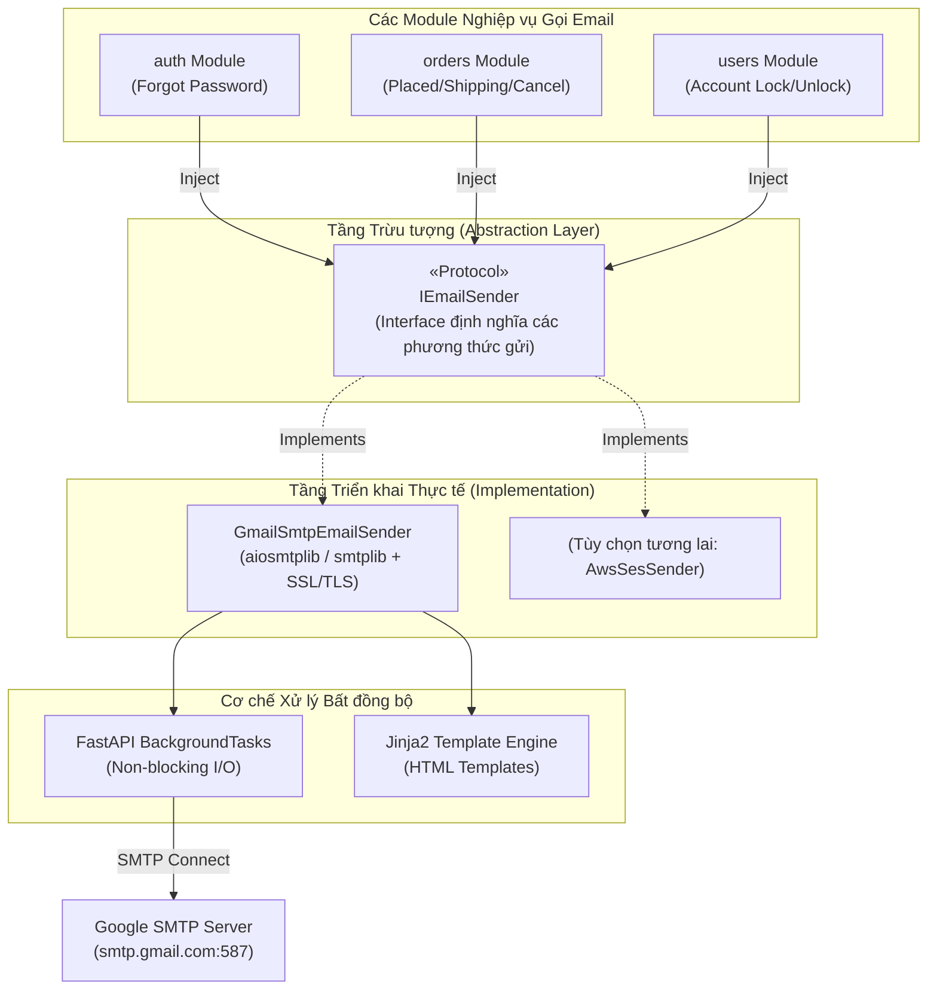
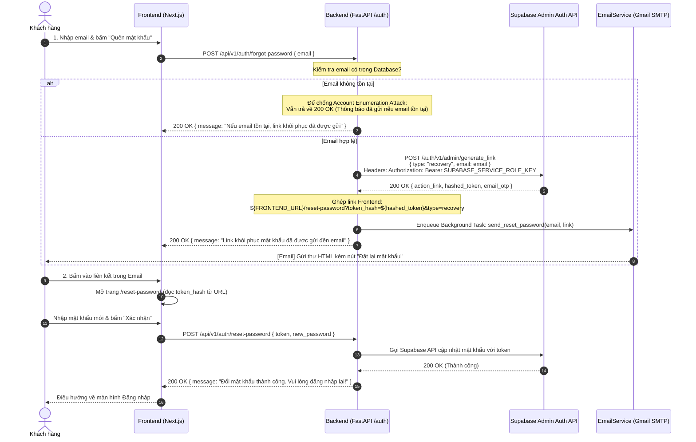

# Kế hoạch Kỹ thuật: Phân hệ Gửi Email (Gmail SMTP) & Quên/Đặt lại Mật khẩu (Supabase Admin)

> **Mục tiêu:** Xây dựng module dịch vụ gửi Email dùng chung độc lập, linh hoạt và chuẩn hóa kiến trúc với `Protocol`, tích hợp gửi thư tự động qua Google Gmail SMTP (sử dụng App Password) và xây dựng quy trình Quên / Lấy lại mật khẩu an toàn sử dụng Supabase Admin API (`generate_link`).

---

## 1. Tổng quan Nghiệp vụ & Phạm vi Hệ thống

Hệ thống Email được thiết kế như một **Service Module độc lập** trong Backend FastAPI. Các module nghiệp vụ khác (`auth`, `orders`, `users`, `promotions`...) chỉ tương tác qua Interface/Protocol trừu tượng, không phụ thuộc vào hạ tầng gửi mail thực tế.

### 1.1. Các kịch bản gửi Email trong hệ thống
| STT | Kịch bản / Sự kiện | Module kích hoạt | Nội dung thông điệp |
| :--- | :--- | :--- | :--- |
| **1** | **Lấy lại mật khẩu** | `auth` | Gửi link an toàn có kèm token để người dùng chuyển tới trang đổi mật khẩu mới (thời hạn 15 phút). |
| **2** | **Đặt hàng thành công** | `orders` | Xác nhận đơn hàng, chi tiết giỏ hàng, tổng tiền, phương thức thanh toán, kèm link thanh toán lại (nếu là VNPAY chưa thanh toán). |
| **3** | **Đang giao hàng** | `orders` / `shipper` | Thông báo kiện hàng đã xuất kho và giao cho bưu tá, mã vận đơn (tracking code), kèm thông tin hóa đơn tóm tắt. |
| **4** | **Giao hàng thành công** | `orders` / `shipper` | Xác nhận đơn đã phát thành công, đính kèm link xem hóa đơn điện tử, thông tin liên hệ khiếu nại / hoàn hàng 7 ngày. |
| **5** | **Đơn hàng bị hủy** | `orders` | Thông báo hủy đơn kèm lý do chi tiết (Hết hàng, Khách yêu cầu, Quá hạn thanh toán 24h), hướng dẫn hoàn tiền (nếu có). |
| **6** | **Tài khoản bị khóa / mở lại** | `admin` / `users` | Thông báo tài khoản bị khóa kèm điều khoản vi phạm & kênh hỗ trợ; hoặc thông báo mở khóa thành công. |
| **7** | **Khuyến mãi / Ưu đãi (Mở rộng)** | `promotions` | Email marketing gửi voucher, giảm giá sinh nhật, flash sale cho tệp khách hàng thân thiết. |

### 1.2. Giải pháp hạ tầng gửi mail: Google Gmail SMTP
* **Giao thức:** SMTP (`smtp.gmail.com`).
* **Cổng kết nối:** Port `587` (STARTTLS) hoặc Port `465` (SSL/TLS).
* **Cơ chế xác thực:** Google Workspace / Gmail cá nhân kích hoạt 2FA và tạo **Mật khẩu ứng dụng (App Password - 16 ký tự)**.
* **Hạn mức (Quota):** ~500 emails/ngày đối với tài khoản cá nhân thông thường (đáp ứng tốt giai đoạn thử nghiệm và vận hành cửa hàng ban đầu).
* **Ưu điểm kiến trúc:** Không tốn chi phí phát sinh, độ tin cậy inbox cao, không bị rơi vào spam như tự dựng mail server riêng. Sau này khi phát triển lớn có thể chuyển đổi sang Amazon SES, SendGrid hoặc Resend mà không cần đổi một dòng code nghiệp vụ nhờ `Protocol`.

---

## 2. Kiến trúc & Nguyên tắc Thiết kế (Design Principles)



### 2.1. Dependency Inversion Principle (DIP) với `typing.Protocol`
* Sử dụng **Python Structural Subtyping (`typing.Protocol`)** làm interface.
* Các module nghiệp vụ phụ thuộc vào `IEmailSender`, không phụ thuộc vào `smtplib` hay thư viện ngoài.
* **Lợi ích:**
  1. Dễ dàng viết Unit Test (mock sender không cần gửi mail thật và không cần kết nối mạng).
  2. Dễ dàng thay đổi nhà cung cấp hạ tầng (Gmail SMTP $\rightarrow$ SendGrid / Resend / AWS SES) chỉ bằng cách đổi cấu hình khởi tạo.

### 2.2. Xử lý Bất đồng bộ (Non-blocking I/O)
* Gửi email qua SMTP có độ trễ mạng từ 1 - 3 giây.
* **Bắt buộc** chạy qua `BackgroundTasks` của FastAPI: Request API phản hồi ngay lập tức cho người dùng (`200 OK`), tác vụ render template và kết nối SMTP được thực thi ngầm trên nền.

---

## 3. Cấu trúc Thư mục Module Backend

Toàn bộ nghiệp vụ email được đặt tại `backend/src/app/modules/emails/` tuân thủ đúng chuẩn quy định tại `DEVELOPMENT_GUIDELINES.md`:

```text
backend/
├── src/
│   └── app/
│       ├── core/
│       │   ├── config.py              # Bổ sung các biến cấu hình SMTP & Supabase Admin Key
│       │   └── ...
│       │
│       └── modules/
│           ├── emails/                # MODULE DỊCH VỤ EMAIL MỚI
│           │   ├── __init__.py        # Export IEmailSender, EmailService, get_email_sender
│           │   ├── protocol.py        # Định nghĩa IEmailSender Interface (typing.Protocol)
│           │   ├── schema.py          # Schemas / DTOs cho các loại email context
│           │   ├── service.py         # Triển khai GmailSmtpEmailSender
│           │   ├── dependencies.py    # FastAPI Dependency Injection (get_email_sender)
│           │   ├── templates/         # Thư mục HTML Templates (Jinja2)
│           │   │   ├── base.html              # Layout chung: header, brand logo, footer
│           │   │   ├── reset_password.html    # Template quên mật khẩu
│           │   │   ├── order_placed.html      # Đặt hàng thành công (+ link thanh toán)
│           │   │   ├── order_shipping.html    # Thông báo đơn đang giao + mã vận đơn
│           │   │   ├── order_delivered.html   # Thông báo đơn đã giao thành công
│           │   │   ├── order_cancelled.html   # Thông báo đơn bị hủy kèm lý do
│           │   │   └── account_status.html    # Khóa / Mở lại tài khoản
│           │   └── router.py          # (Tùy chọn) Endpoint cho Admin test cấu hình gửi mail
│           │
│           ├── auth/                  # CẬP NHẬT MODULE AUTH
│           │   ├── router.py          # Thêm POST /auth/forgot-password, POST /auth/reset-password
│           │   ├── schema.py          # Thêm ForgotPasswordRequest, ResetPasswordRequest
│           │   └── service.py         # Gọi Supabase Admin generate_link & gửi mail qua EmailService
│           │
│           └── orders/                # TÍCH HỢP GỬI EMAIL VÀO VÒNG ĐỜI ĐƠN HÀNG
│               └── service.py         # Gọi IEmailSender khi tạo đơn, đổi trạng thái
```

---

## 4. Đặc tả Chi tiết Kỹ thuật: Interface, Methods & Schemas

### 4.1. Định nghĩa Interface `IEmailSender` (`protocol.py`)

```python
# backend/src/app/modules/emails/protocol.py
from typing import Any, Protocol, runtime_checkable
from fastapi import BackgroundTasks


@runtime_checkable
class IEmailSender(Protocol):
    """Protocol chuẩn hóa toàn bộ nghiệp vụ gửi email của hệ thống."""

    def send_email(
        self,
        to_email: str,
        subject: str,
        template_name: str,
        context: dict[str, Any],
        background_tasks: BackgroundTasks | None = None,
    ) -> None:
        """Gửi email dựa trên Jinja2 template (chạy ngầm nếu có background_tasks)."""
        ...

    def send_reset_password(
        self,
        to_email: str,
        customer_name: str,
        reset_link: str,
        expire_minutes: int = 15,
        background_tasks: BackgroundTasks | None = None,
    ) -> None:
        """Gửi email khôi phục mật khẩu."""
        ...

    def send_order_placed(
        self,
        to_email: str,
        customer_name: str,
        order_code: str,
        items: list[dict[str, Any]],
        total_amount: str,
        payment_method: str,
        payment_url: str | None = None,
        background_tasks: BackgroundTasks | None = None,
    ) -> None:
        """Gửi email xác nhận đặt hàng kèm link thanh toán nếu có."""
        ...

    def send_order_shipping(
        self,
        to_email: str,
        customer_name: str,
        order_code: str,
        tracking_code: str | None,
        shipping_address: str,
        total_amount: str,
        background_tasks: BackgroundTasks | None = None,
    ) -> None:
        """Gửi email thông báo đơn hàng đang được vận chuyển."""
        ...

    def send_order_delivered(
        self,
        to_email: str,
        customer_name: str,
        order_code: str,
        delivered_at: str,
        background_tasks: BackgroundTasks | None = None,
    ) -> None:
        """Gửi email thông báo giao hàng thành công."""
        ...

    def send_order_cancelled(
        self,
        to_email: str,
        customer_name: str,
        order_code: str,
        cancel_reason: str,
        background_tasks: BackgroundTasks | None = None,
    ) -> None:
        """Gửi email thông báo hủy đơn hàng."""
        ...

    def send_account_status_changed(
        self,
        to_email: str,
        customer_name: str,
        is_locked: bool,
        reason: str | None = None,
        background_tasks: BackgroundTasks | None = None,
    ) -> None:
        """Gửi email thông báo tài khoản bị khóa hoặc được kích hoạt lại."""
        ...
```

### 4.2. Schemas & Data Models (`schema.py`)

```python
# backend/src/app/modules/emails/schema.py
from decimal import Decimal
from pydantic import BaseModel, EmailStr, Field


class EmailItemSummary(BaseModel):
    """Tóm tắt sản phẩm trong đơn hàng gửi email."""
    product_name: str = Field(..., description="Tên sản phẩm")
    variant_info: str | None = Field(None, description="Màu sắc, kích thước nếu có")
    quantity: int = Field(..., gt=0, description="Số lượng")
    unit_price: Decimal = Field(..., description="Đơn giá")
    subtotal: Decimal = Field(..., description="Thành tiền")


class ForgotPasswordRequest(BaseModel):
    """Yêu cầu gửi mail khôi phục mật khẩu."""
    email: EmailStr = Field(..., description="Email tài khoản cần khôi phục", examples=["user@example.com"])


class ResetPasswordRequest(BaseModel):
    """Đổi mật khẩu mới kèm mã token xác thực."""
    token: str = Field(..., min_length=1, description="Recovery Token từ Supabase")
    new_password: str = Field(..., min_length=6, max_length=64, description="Mật khẩu mới", examples=["NewSecurePass@2026"])


class TestEmailRequest(BaseModel):
    """DTO cho endpoint test gửi mail của Admin."""
    to_email: EmailStr = Field(..., description="Email người nhận")
    subject: str = Field(default="[ShopApp] Test Email Connection")
    content: str = Field(default="Kiểm tra kết nối gửi email SMTP thành công!")
```

### 4.3. Triển khai Service `GmailSmtpEmailSender` (`service.py`)

* Sử dụng `smtplib` và `email.mime` (chuẩn Python standard library, không phát sinh dependency phức tạp).
* Tích hợp `jinja2.Environment` tải templates từ thư mục `templates/`.
* Quản lý lỗi tập trung: Bọc toàn bộ ngoại lệ kết nối SMTP (`SMTPAuthenticationError`, `SMTPConnectError`), ghi log chi tiết mà không làm crash luồng chính của người dùng.

---

## 5. Cấu hình Hệ thống & Biến Môi trường (Configuration)

### 5.1. Bổ sung cấu hình vào `.env.local.example` và `.env.local`

```env
# ==============================================================================
# EMAIL (GOOGLE GMAIL SMTP)
# ==============================================================================
SMTP_HOST=smtp.gmail.com
SMTP_PORT=587
SMTP_USER=your_email@gmail.com
SMTP_PASSWORD=xxxx xxxx xxxx xxxx
SMTP_FROM_NAME="Shop App Platform"
SMTP_FROM_EMAIL=your_email@gmail.com
SMTP_TLS=True

# ==============================================================================
# FRONTEND URL (Dùng tạo liên kết trong email)
# ==============================================================================
FRONTEND_URL=http://localhost:3000

# ==============================================================================
# SUPABASE ADMIN CREDENTIALS (Dùng cho Admin API generate_link)
# ==============================================================================
# Service Role Key có toàn quyền bypass RLS và gọi các chức năng Admin Auth
SUPABASE_SERVICE_ROLE_KEY=your_supabase_service_role_secret_key_here
```

### 5.2. Cập nhật `backend/src/app/core/config.py`

```python
class Settings(BaseSettings):
    # ... Các biến hiện tại ...

    # SMTP Configuration
    SMTP_HOST: str = Field(default="smtp.gmail.com")
    SMTP_PORT: int = Field(default=587)
    SMTP_USER: str = Field(default="")
    SMTP_PASSWORD: str = Field(default="")
    SMTP_FROM_NAME: str = Field(default="Shop App Platform")
    SMTP_FROM_EMAIL: str = Field(default="")
    SMTP_TLS: bool = Field(default=True)

    # Frontend URL
    FRONTEND_URL: str = Field(default="http://localhost:3000")

    # Supabase Admin
    SUPABASE_SERVICE_ROLE_KEY: str = Field(default="")
```

### 5.3. Hướng dẫn lấy Google App Password
1. Truy cập tài khoản Google: [https://myaccount.google.com/](https://myaccount.google.com/).
2. Vào mục **Bảo mật (Security)** $\rightarrow$ Bật **Xác minh 2 bước (2-Step Verification)**.
3. Tìm kiếm **"Mật khẩu ứng dụng" (App passwords)**.
4. Đặt tên ứng dụng là `ShopAppBackend` $\rightarrow$ Nhấn **Tạo (Create)**.
5. Google sẽ tạo chuỗi mật khẩu 16 ký tự (ví dụ: `abcd efgh ijkl mnop`). Copy chuỗi này dán vào biến `SMTP_PASSWORD`.

---

## 6. Phân hệ Quên & Lấy lại Mật khẩu với Supabase Admin API

### 6.1. Tại sao dùng `generate_link` của Supabase Admin API?
Mặc định, Supabase Auth có tính năng gửi mail tự động nhưng gặp các nhược điểm:
* Mẫu email mặc định sơ sài, khó tùy biến HTML/CSS thương hiệu tiếng Việt.
* Tỉ lệ vào Spam cao nếu chưa cấu hình Custom SMTP trong Supabase dashboard.
* Bằng cách dùng `auth.admin.generate_link(type="recovery")`:
  1. Supabase chỉ tạo ra **Token** và **Action URL** bảo mật.
  2. Supabase **không** gửi email.
  3. Backend chủ động nhúng đường dẫn vào mẫu email HTML đẹp mắt và gửi qua Google Gmail SMTP đã cấu hình.

### 6.2. Sơ đồ Luồng Thực thi Quên & Đổi mật khẩu



### 6.3. Chi tiết API Endpoints Phân hệ Auth

#### 1. API Yêu cầu Khôi phục (`POST /api/v1/auth/forgot-password`)
* **Mô tả:** Tiếp nhận email từ người dùng, gọi Supabase Admin API lấy `hashed_token` và điều phối gửi email ngầm.
* **Bảo mật:**
  * Rate-limit: Tối đa 3 lần / phút trên cùng 1 địa chỉ IP để chống brute-force / spam gửi mail làm cạn hạn ngạch Gmail.
  * Constant-time / Vague response: Không tiết lộ email có tồn tại trong hệ thống hay không.

#### 2. API Đặt lại Mật khẩu Mới (`POST /api/v1/auth/reset-password`)
* **Request:** `{ "token": "string", "new_password": "string" }`
* **Xử lý:** Backend xác minh token qua Supabase Auth API (`verify_otp` hoặc admin update) và cập nhật mật khẩu mới vào bảng auth của Supabase.
* **Response:** `{ "status": "success", "message": "Đặt lại mật khẩu thành công" }`

---

## 7. Mẫu Thiết kế Giao diện Email (Email HTML Templates)

Tất cả mẫu email đều tuân thủ các quy tắc hiển thị chuẩn trên mọi thiết bị di động và máy tính:
* Thiết kế dạng thẻ (Card Layout) với tông màu thương hiệu rõ ràng, font chữ hệ thống không lỗi tiếng Việt (`Segoe UI, Roboto, Helvetica, Arial`).
* Nút kêu gọi hành động (Call to Action - CTA) dạng khối lớn, bo góc, màu nổi bật (Primary Color).
* Chân trang (Footer) hiển thị rõ lý do nhận mail, link điều khoản và hotline hỗ trợ.

### Xem trước cấu trúc Template cơ sở (`base.html`):
```html
<!DOCTYPE html>
<html lang="vi">
<head>
  <meta charset="UTF-8">
  <meta name="viewport" content="width=device-width, initial-scale=1.0">
  <title>{{ subject }}</title>
  <style>
    body { font-family: -apple-system, BlinkMacSystemFont, 'Segoe UI', Roboto, Helvetica, Arial, sans-serif; background-color: #f4f6f8; margin: 0; padding: 24px; color: #1e293b; }
    .container { max-width: 600px; margin: 0 auto; background: #ffffff; border-radius: 12px; overflow: hidden; box-shadow: 0 4px 6px -1px rgba(0, 0, 0, 0.1); }
    .header { background: #0f172a; padding: 24px; text-align: center; }
    .brand { color: #ffffff; font-size: 20px; font-weight: bold; letter-spacing: 0.5px; }
    .content { padding: 32px 28px; line-height: 1.6; }
    .btn { display: inline-block; padding: 12px 28px; background-color: #2563eb; color: #ffffff !important; text-decoration: none; border-radius: 8px; font-weight: 600; margin-top: 16px; }
    .footer { padding: 20px; text-align: center; font-size: 12px; color: #64748b; background-color: #f8fafc; border-top: 1px solid #e2e8f0; }
  </style>
</head>
<body>
  <div class="container">
    <div class="header">
      <div class="brand">SHOP APP PLATFORM</div>
    </div>
    <div class="content">
      
    </div>
    <div class="footer">
      <p>© 2026 Shop App Platform. Mọi quyền được bảo lưu.</p>
      <p>Nếu bạn không thực hiện yêu cầu này, vui lòng bỏ qua email hoặc liên hệ bộ phận hỗ trợ.</p>
    </div>
  </div>
</body>
</html>
```

---

## 8. Lộ trình Triển khai Chi tiết (Implementation Checklist)

- [x] **Giai đoạn 1: Chuẩn bị Cấu hình & Hạ tầng**
  - [x] Bổ sung các biến `SMTP_*` và `SUPABASE_SERVICE_ROLE_KEY` vào `backend/src/app/core/config.py`.
  - [x] Cập nhật file `.env.local.example` để hướng dẫn nhóm lập trình viên cấu hình.
  - [x] Cài đặt thư viện cần thiết (`jinja2`, `httpx` vào `pyproject.toml`).

- [x] **Giai đoạn 2: Xây dựng Module Email (`src/app/modules/emails`)**
  - [x] Tạo file `protocol.py` chứa interface `IEmailSender`.
  - [x] Tạo file `schema.py` chứa các DTOs dữ liệu email.
  - [x] Tạo file `service.py` triển khai `GmailSmtpEmailSender` với các phương thức gửi qua SMTP và Jinja2 render.
  - [x] Xây dựng bộ thư mục templates HTML: `reset_password.html`, `order_placed.html`, `order_shipping.html`, `order_delivered.html`, `order_cancelled.html`, `account_status.html`.
  - [x] Tạo file `dependencies.py` cung cấp dependency `get_email_sender`.
  - [x] Tạo file `router.py` cung cấp endpoint kiểm tra kết nối SMTP (`POST /api/v1/emails/test`).

- [x] **Giai đoạn 3: Tích hợp Quên & Đặt lại Mật khẩu (`src/app/modules/auth`)**
  - [x] Thêm logic gọi Supabase Admin Auth API (`admin/generate_link`) và bảo vệ chống Account Enumeration.
  - [x] Thêm endpoint `POST /api/v1/auth/forgot-password` trong `auth/router.py`.
  - [x] Thêm endpoint `POST /api/v1/auth/reset-password` trong `auth/router.py`.
  - [x] Kết nối `BackgroundTasks` gửi email khôi phục mật khẩu.

- [x] **Giai đoạn 4: Tích hợp Gửi Email vào Vòng đời Đơn hàng & Người dùng**
  - [x] Tích hợp `send_order_placed` khi tạo đơn hàng thành công (kèm link VNPAY nếu thanh toán online).
  - [x] Tích hợp `send_order_shipping` khi chuyển trạng thái đơn hàng sang `SHIPPING`.
  - [x] Tích hợp `send_order_delivered` khi chuyển trạng thái đơn hàng sang `DELIVERED` hoặc `COMPLETED`.
  - [x] Tích hợp `send_order_cancelled` khi đơn hàng bị hủy bởi người dùng hoặc quản trị viên.
  - [x] Tích hợp `send_account_status_changed` khi Admin khóa/mở khóa tài khoản người dùng.

- [x] **Giai đoạn 5: Kiểm thử & Đánh giá (Testing & Verification)**
  - [x] Tạo test suite mock `IEmailSender` và Supabase Admin API (`backend/tests/test_email_and_auth_reset_service.py`) đạt 100% pass (13/13 tests).
  - [x] Kiểm tra tương thích không hồi quy đối với toàn bộ test suites hiện tại.
